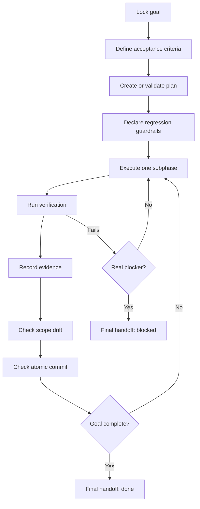

# Megaskill

Megaskill is a high-rigor execution skill for AI coding agents. It turns a broad coding goal into a guarded, step-by-step execution loop with explicit acceptance criteria, regression guardrails, atomic commits, verification evidence, and a final done/blocked/not-done verdict.

Use it when an agent needs to write a decision-complete plan for lower-level agents, prevent scope drift, execute iteratively, and prove the result with real checks instead of handing work back early.

## What It Provides

- Goal locking with acceptance criteria and out-of-scope boundaries.
- Plan validation for phases, subphases, tests, success criteria, planned touch files, and checklist items.
- Regression guardrail prompts before file edits.
- Scope drift checks against changed, staged, and untracked files.
- Atomic commit checks for staged changes.
- Evidence recording for verification commands.
- Final handoff structure with a clear `done`, `blocked`, or `not done` verdict.

## Execution Loop



## Install

### Codex

Recommended Codex install:

```bash
python3 ~/.codex/skills/.system/skill-installer/scripts/install-skill-from-github.py \
  --repo Kassden/megaskill \
  --path . \
  --name megaskill
```

For an editable install, clone this repo directly into your Codex skills directory:

```bash
mkdir -p ~/.codex/skills
git clone https://github.com/Kassden/megaskill.git ~/.codex/skills/megaskill
```

Restart Codex or start a new session, then ask for `$megaskill`.

### Claude Code

Install as a personal Claude Code skill:

```bash
mkdir -p ~/.claude/skills
git clone https://github.com/Kassden/megaskill.git ~/.claude/skills/megaskill
```

Or install it for one project:

```bash
mkdir -p .claude/skills
git clone https://github.com/Kassden/megaskill.git .claude/skills/megaskill
```

Restart Claude Code or start a new session, then ask Claude to use Megaskill for guarded execution planning and verification.

## Quick Start

Run commands from the Megaskill folder:

```bash
cd ~/.codex/skills/megaskill
```

Create a plan skeleton:

```bash
PYTHONDONTWRITEBYTECODE=1 python3 scripts/mega_plan_init.py \
  "Execution Plan" \
  --goal "Ship the requested change with tests and evidence" \
  --phases "Discovery,Implementation,Verification" \
  --output PLAN.md
```

Validate a plan before execution:

```bash
PYTHONDONTWRITEBYTECODE=1 python3 scripts/mega_plan_check.py PLAN.md
```

Check scope drift against the plan:

```bash
PYTHONDONTWRITEBYTECODE=1 python3 scripts/mega_scope_check.py PLAN.md
```

Check only staged files before committing:

```bash
PYTHONDONTWRITEBYTECODE=1 python3 scripts/mega_scope_check.py PLAN.md --staged
PYTHONDONTWRITEBYTECODE=1 python3 scripts/mega_commit_check.py
```

Record evidence for checks:

```bash
PYTHONDONTWRITEBYTECODE=1 python3 scripts/mega_evidence.py run \
  --phase "1.1" \
  -- npm test
```

Summarize recorded evidence:

```bash
PYTHONDONTWRITEBYTECODE=1 python3 scripts/mega_evidence.py summary
```

## Example Goal And Research Plan

Use this shape when assigning work to a lower-level coding agent. The important part is that each subphase is decision-complete: it names what to inspect, what may be edited, what proves success, and what must be checked off before moving on.

```markdown
# Add Cached Customer Search

## GOAL
- Add server-side caching to customer search so repeated identical queries return faster without changing search results, permissions, or API response shape.

## Acceptance Criteria
- [ ] Identical customer search requests reuse cached results within a 60 second TTL.
- [ ] Users only receive results they are authorized to see.
- [ ] Existing search response JSON remains backward compatible.
- [ ] Cache behavior is covered by targeted tests.
- [ ] Verification evidence is recorded before final handoff.

## Research
- Built-in options:
  - Inspect the existing search API route, service layer, auth checks, and cache utilities already in the repo.
  - Prefer existing framework cache primitives if the app already uses them.
- Off-the-shelf options:
  - Consider Redis or the platform cache only if the repo already has that dependency or production config.
  - Do not introduce a new cache service for this subphase unless existing infrastructure proves it is available.
- Official / standards sources:
  - Check framework docs for cache invalidation and runtime constraints if a built-in cache is used.
  - Check existing project docs for data privacy, tenancy, or authorization rules.

## Regression Guardrails
- Planned edit surface:
  - `src/api/customers/search.ts`
  - `src/services/customer-search.ts`
  - `tests/customer-search-cache.test.ts`
- Protected behaviors:
  - Authorization filtering, response schema, pagination, sorting, and empty-state behavior.
- Likely consumers:
  - Customer search UI, saved-search workflows, API clients, and support tooling.
- Damage radius:
  - Moderate: API behavior and shared service path.
- Proof plan:
  - Run targeted cache tests, existing customer search tests, typecheck, and one manual API smoke if the app has a local dev server.

## Phase 1: Discovery

### Subphase 1.1: Map Search Flow
- Commit: docs/plan only if a durable plan file is being committed; otherwise no commit.
- Tests: no code tests; evidence is file/path inventory and confirmed call flow.
- Success Criteria: exact API route, service function, auth boundary, and test locations are known.
- Planned Touch Files:
  - `MEGA_PLAN.md`
- Checklist:
  - [ ] Read the search route and identify request parameters.
  - [ ] Trace the service function that produces search results.
  - [ ] Identify where authorization or tenant filtering happens.
  - [ ] Identify existing tests that must keep passing.
  - [ ] Record findings in the plan before editing code.

## Phase 2: Implementation

### Subphase 2.1: Add Cache Key And TTL
- Commit: add customer search cache key and TTL handling.
- Tests: `npm test -- customer-search-cache`
- Success Criteria: identical authorized queries can hit the cache while distinct users, tenants, query params, sort order, and pages produce separate cache keys.
- Planned Touch Files:
  - `src/services/customer-search.ts`
  - `tests/customer-search-cache.test.ts`
- Checklist:
  - [ ] Build the cache key from user/tenant identity and normalized search params.
  - [ ] Set TTL to 60 seconds.
  - [ ] Avoid caching authorization failures.
  - [ ] Add tests for cache hit, cache miss, and cross-user isolation.
  - [ ] Run targeted tests and record evidence.
  - [ ] Run `scripts/mega_scope_check.py MEGA_PLAN.md --staged` before commit.

### Subphase 2.2: Preserve API Contract
- Commit: preserve customer search API response shape with cached results.
- Tests: `npm test -- customer-search` and `npm run typecheck`
- Success Criteria: cached and uncached responses have the same JSON shape, status codes, pagination fields, and sorting behavior.
- Planned Touch Files:
  - `src/api/customers/search.ts`
  - `tests/customer-search-cache.test.ts`
- Checklist:
  - [ ] Confirm the route still delegates authorization to the same boundary.
  - [ ] Add or update a response-shape assertion.
  - [ ] Run targeted search tests.
  - [ ] Run typecheck.
  - [ ] Record evidence for each verification command.
  - [ ] Run `scripts/mega_commit_check.py` before commit.

## Phase 3: Verification

### Subphase 3.1: Final Evidence And Handoff
- Commit: none unless verification docs are committed.
- Tests: targeted tests, typecheck, and optional local API smoke.
- Success Criteria: final handoff can state `done` with evidence, or name a precise blocker.
- Planned Touch Files:
  - `.mega/evidence.jsonl`
- Checklist:
  - [ ] Run `scripts/mega_evidence.py summary`.
  - [ ] Confirm no unplanned files remain changed.
  - [ ] Confirm commits are pushed if publishing is in scope.
  - [ ] Write final handoff with verified surfaces, unverified surfaces, and verdict.
```

## Scripts

| Script | Purpose |
| --- | --- |
| `scripts/mega_plan_init.py` | Creates a canonical execution plan skeleton. |
| `scripts/mega_plan_check.py` | Validates plan structure before execution. |
| `scripts/mega_scope_check.py` | Compares planned touch files with working-tree, staged, and untracked changes. |
| `scripts/mega_commit_check.py` | Checks whether staged files look like one atomic commit. |
| `scripts/mega_evidence.py` | Records and summarizes verification evidence. |

## Skill Files

- `SKILL.md`: skill entrypoint and routing instructions.
- `references/execution-contract.md`: full execution loop and blocker rules.
- `references/agent-plan-template.md`: template for lower-level agent plans.
- `references/final-handoff-template.md`: final response proof block.
- `agents/openai.yaml`: OpenAI agent interface metadata.

## License

MIT
