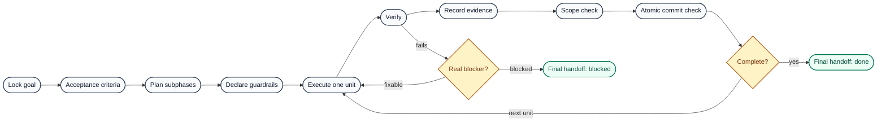

# Megaskill

<pre align="center">
███╗   ███╗███████╗ ██████╗  █████╗ ███████╗██╗  ██╗██╗██╗     ██╗     
████╗ ████║██╔════╝██╔════╝ ██╔══██╗██╔════╝██║ ██╔╝██║██║     ██║     
██╔████╔██║█████╗  ██║  ███╗███████║███████╗█████╔╝ ██║██║     ██║     
██║╚██╔╝██║██╔══╝  ██║   ██║██╔══██║╚════██║██╔═██╗ ██║██║     ██║     
██║ ╚═╝ ██║███████╗╚██████╔╝██║  ██║███████║██║  ██╗██║███████╗███████╗
╚═╝     ╚═╝╚══════╝ ╚═════╝ ╚═╝  ╚═╝╚══════╝╚═╝  ╚═╝╚═╝╚══════╝╚══════╝
</pre>

<p align="center"><strong>A high-rigor execution skill for AI coding agents</strong></p>

<p align="center">
  <a href="https://github.com/Kassden/megaskill/stargazers"></a>
  <a href="https://github.com/Kassden/megaskill/forks"></a>
  <a href="https://github.com/Kassden/megaskill/watchers"></a>
  
  <a href="https://tokei.kojix2.net/github/Kassden/megaskill"></a>
  
  
  
  <a href="https://github.com/Kassden/megaskill/commits/main"></a>
  <a href="https://github.com/Kassden/megaskill/commits/main"></a>
  <a href="https://github.com/Kassden/megaskill/blob/main/LICENSE"></a>
</p>

<p align="center">
  <a href="https://github.com/Kassden/megaskill#install"></a>
  <a href="https://github.com/Kassden/megaskill#quick-start"></a>
  <a href="https://github.com/Kassden/megaskill#execution-loop"></a>
</p>

Megaskill is a high-rigor execution skill for AI coding agents. It turns a broad coding goal into a guarded, step-by-step execution loop with explicit acceptance criteria, regression guardrails, atomic commits, verification evidence, and a final done/blocked/not-done verdict.

Use it when an agent needs to write a decision-complete plan for lower-level agents, prevent scope drift, execute iteratively, and prove the result with real checks instead of handing work back early.

## What It Provides

- Goal locking with acceptance criteria and out-of-scope boundaries.
- Plan validation for SOTA/standards research, dependency/tooling preflight, deterministic real-user tests, fulfillment/readback proof, Armageddon mode, generality guardrails, phases, subphases, tests, success criteria, planned touch files, and checklist items.
- Regression guardrail prompts before file edits.
- Scope drift checks against changed, staged, and untracked files.
- Atomic commit checks for staged changes.
- Evidence recording for verification commands.
- Final handoff structure with a clear `done`, `blocked`, or `not done` verdict.

## Autonomy Rule

Missing verification tooling is setup work, not a reason to skip relevant checks. If the requested work needs a verification surface, Megaskill expects the agent to install or repair project-local tooling and continue.

For UI, visual, browser, canvas, 3D, or game work, use the repo's existing browser-test stack or add project-local Playwright tooling when absent, install required browser binaries, and run the browser smoke, screenshot, visual, or pixel checks that match the change. Only skip relevant verification for a real blocker: denied approval, missing credentials, incompatible platform, external outage, destructive-action boundary, or product decision that cannot be inferred.

## SOTA And Standards Rule

When building or adding a capability, Megaskill requires current SOTA, standards, and best-practices research before design and implementation. The plan must cover prior art, official docs/specs/platform guidance, mature libraries or built-in mechanisms, best-practice constraints to integrate, rejected approaches, and the resulting implementation decision.

The research is not decorative. The selected standard, official API, mature library, or project pattern must shape the implementation and tests.

## Real-User And Armageddon Checks

For interfaces, apps, tools, CLIs, workflows, and user-facing surfaces, Megaskill requires a deterministic real-user experience test before broader verification. The test starts from the user's actual entry point, performs the core workflow with stable inputs or fixtures, and asserts user-observable outcomes.

For artifact-producing and external-write workflows, Megaskill also requires fulfillment/readback proof. Creating a file, copying a template, routing to the right tool family, or returning a link is not enough. The plan must identify the required write or mutation operation, read back the final user-visible result, and compare the content, rows, fields, counts, behavior, or side effect against the acceptance criteria.

Armageddon mode is the adversarial pass: it tears apart UI, APIs, tools, data paths, deploys, and workflows with bad inputs, edge states, repeated actions, failed dependencies, screenshots, console/network checks, error-shape checks, and optimization probes. Scale it to the damage radius before calling work done.

## General-Solution Guardrail

Before implementing, Megaskill checks whether the request is one instance of a broader pattern. Use the existing general mechanism when one exists. If no general mechanism exists and recurrence is likely, create the general mechanism first, then implement the specific request through it. Only choose a one-off when it is truly isolated, low-risk, and unlikely to recur.

## Execution Loop



## Install

### Codex

Recommended Codex install:

```bash
python3 ~/.codex/skills/.system/skill-installer/scripts/install-skill-from-github.py \
  --repo Kassden/megaskill \
  --path . \
  --name megaskill
```

For an editable install, clone this repo directly into your Codex skills directory:

```bash
mkdir -p ~/.codex/skills
git clone https://github.com/Kassden/megaskill.git ~/.codex/skills/megaskill
```

Restart Codex or start a new session, then ask for `$megaskill`.

### Claude Code

Install as a personal Claude Code skill:

```bash
mkdir -p ~/.claude/skills
git clone https://github.com/Kassden/megaskill.git ~/.claude/skills/megaskill
```

Or install it for one project:

```bash
mkdir -p .claude/skills
git clone https://github.com/Kassden/megaskill.git .claude/skills/megaskill
```

Restart Claude Code or start a new session, then ask Claude to use Megaskill for guarded execution planning and verification.

## Quick Start

Run commands from the Megaskill folder:

```bash
cd ~/.codex/skills/megaskill
```

Create a plan skeleton:

```bash
PYTHONDONTWRITEBYTECODE=1 python3 scripts/mega_plan_init.py \
  "Execution Plan" \
  --goal "Ship the requested change with tests and evidence" \
  --phases "Discovery,Implementation,Verification" \
  --output PLAN.md
```

Validate a plan before execution:

```bash
PYTHONDONTWRITEBYTECODE=1 python3 scripts/mega_plan_check.py PLAN.md
```

Check scope drift against the plan:

```bash
PYTHONDONTWRITEBYTECODE=1 python3 scripts/mega_scope_check.py PLAN.md
```

Check only staged files before committing:

```bash
PYTHONDONTWRITEBYTECODE=1 python3 scripts/mega_scope_check.py PLAN.md --staged
PYTHONDONTWRITEBYTECODE=1 python3 scripts/mega_commit_check.py
```

Record evidence for checks:

```bash
PYTHONDONTWRITEBYTECODE=1 python3 scripts/mega_evidence.py run \
  --phase "1.1" \
  -- npm test
```

Summarize recorded evidence:

```bash
PYTHONDONTWRITEBYTECODE=1 python3 scripts/mega_evidence.py summary
```

## Example Goal And Research Plan

Use this shape when assigning work to a lower-level coding agent. The important part is that each subphase is decision-complete: it names what to inspect, what may be edited, what proves success, and what must be checked off before moving on.

```markdown
# Add Cached Customer Search

## GOAL
- Add server-side caching to customer search so repeated identical queries return faster without changing search results, permissions, or API response shape.

## Acceptance Criteria
- [ ] Identical customer search requests reuse cached results within a 60 second TTL.
- [ ] Users only receive results they are authorized to see.
- [ ] Existing search response JSON remains backward compatible.
- [ ] Cache behavior is covered by targeted tests.
- [ ] Verification evidence is recorded before final handoff.

## Research
- Built-in options:
  - Inspect the existing search API route, service layer, auth checks, and cache utilities already in the repo.
  - Prefer existing framework cache primitives if the app already uses them.
- Off-the-shelf options:
  - Consider Redis or the platform cache only if the repo already has that dependency or production config.
  - Do not introduce a new cache service for this subphase unless existing infrastructure proves it is available.
- Official / standards sources:
  - Check framework docs for cache invalidation and runtime constraints if a built-in cache is used.
  - Check existing project docs for data privacy, tenancy, or authorization rules.

## SOTA, Standards, And Best Practices
- Current SOTA / prior art:
  - Use a cache boundary close to the query service, with explicit key construction and TTL.
- Official docs, standards, specs, or platform guidance:
  - Framework caching/runtime docs and project authorization rules.
- Mature libraries, frameworks, or built-in mechanisms:
  - Existing cache helper or platform cache if already present.
- Best-practice constraints to integrate:
  - Include tenant/user identity and normalized query params in the key.
  - Do not cache authorization failures.
- Rejected approaches:
  - Global in-memory cache without tenant isolation.
- Implementation decision:
  - Reuse the project cache utility and add response-shape tests.

## Dependency and Tooling Preflight
- Required verification tools:
  - Existing project test runner.
  - TypeScript typecheck.
  - Local API smoke tool such as `curl` if the app exposes a dev server.
- Existing tooling found:
  - To be filled after reading `package.json` and existing test files.
- Install or repair commands:
  - Use the repo package manager to install missing declared dependencies.
  - Add narrowly scoped project-local test dependencies only when the required proof surface is absent.
- Browser/runtime binaries:
  - Not required unless the cache behavior is exposed through browser-only UI behavior.
- Real blockers that would prevent setup:
  - Missing credentials, denied dependency-install approval, incompatible platform, or external package registry outage.

## Fulfillment and Readback Proof
- Requested final user-visible result:
  - Repeated identical authorized customer searches reuse cached results without response-shape changes.
- Required write/mutation operation:
  - Update the shared customer search service to use the project cache utility.
- Readback surface:
  - API response from cached and uncached requests.
- Expected content, rows, fields, counts, or behavior:
  - Same JSON shape, pagination, sorting, and authorization filtering.
- Command or tool call evidence:
  - Targeted tests and local API smoke when runnable.
- Not-done conditions:
  - Cache code exists but no response readback proves unchanged behavior.

## Regression Guardrails
- Planned edit surface:
  - `src/api/customers/search.ts`
  - `src/services/customer-search.ts`
  - `tests/customer-search-cache.test.ts`
- Protected behaviors:
  - Authorization filtering, response schema, pagination, sorting, and empty-state behavior.
- Likely consumers:
  - Customer search UI, saved-search workflows, API clients, and support tooling.
- Damage radius:
  - Moderate: API behavior and shared service path.
- Proof plan:
  - Run targeted cache tests, existing customer search tests, typecheck, and one manual API smoke if the app has a local dev server.

## Phase 1: Discovery

### Subphase 1.1: Map Search Flow
- Commit: docs/plan only if a durable plan file is being committed; otherwise no commit.
- Tests: no code tests; evidence is file/path inventory and confirmed call flow.
- Success Criteria: exact API route, service function, auth boundary, and test locations are known.
- Planned Touch Files:
  - `MEGA_PLAN.md`
- Checklist:
  - [ ] Read the search route and identify request parameters.
  - [ ] Trace the service function that produces search results.
  - [ ] Identify where authorization or tenant filtering happens.
  - [ ] Identify existing tests that must keep passing.
  - [ ] Record findings in the plan before editing code.

## Phase 2: Implementation

### Subphase 2.1: Add Cache Key And TTL
- Commit: add customer search cache key and TTL handling.
- Tests: `npm test -- customer-search-cache`
- Success Criteria: identical authorized queries can hit the cache while distinct users, tenants, query params, sort order, and pages produce separate cache keys.
- Planned Touch Files:
  - `src/services/customer-search.ts`
  - `tests/customer-search-cache.test.ts`
- Checklist:
  - [ ] Build the cache key from user/tenant identity and normalized search params.
  - [ ] Set TTL to 60 seconds.
  - [ ] Avoid caching authorization failures.
  - [ ] Add tests for cache hit, cache miss, and cross-user isolation.
  - [ ] Run targeted tests and record evidence.
  - [ ] Run `scripts/mega_scope_check.py MEGA_PLAN.md --staged` before commit.

### Subphase 2.2: Preserve API Contract
- Commit: preserve customer search API response shape with cached results.
- Tests: `npm test -- customer-search` and `npm run typecheck`
- Success Criteria: cached and uncached responses have the same JSON shape, status codes, pagination fields, and sorting behavior.
- Planned Touch Files:
  - `src/api/customers/search.ts`
  - `tests/customer-search-cache.test.ts`
- Checklist:
  - [ ] Confirm the route still delegates authorization to the same boundary.
  - [ ] Add or update a response-shape assertion.
  - [ ] Run targeted search tests.
  - [ ] Run typecheck.
  - [ ] Record evidence for each verification command.
  - [ ] Run `scripts/mega_commit_check.py` before commit.

## Phase 3: Verification

### Subphase 3.1: Final Evidence And Handoff
- Commit: none unless verification docs are committed.
- Tests: targeted tests, typecheck, and optional local API smoke.
- Success Criteria: final handoff can state `done` with evidence, or name a precise blocker.
- Planned Touch Files:
  - `.mega/evidence.jsonl`
- Checklist:
  - [ ] Run `scripts/mega_evidence.py summary`.
  - [ ] Confirm no unplanned files remain changed.
  - [ ] Confirm commits are pushed if publishing is in scope.
  - [ ] Write final handoff with verified surfaces, unverified surfaces, and verdict.
```

## Scripts

| Script | Purpose |
| --- | --- |
| `scripts/mega_plan_init.py` | Creates a canonical execution plan skeleton with SOTA research, tooling preflight, real-user testing, fulfillment/readback proof, Armageddon, and generality guardrails. |
| `scripts/mega_plan_check.py` | Validates plan structure, required SOTA/tooling/fulfillment sections, UI/browser proof, and skip-on-missing-tooling loopholes. |
| `scripts/mega_scope_check.py` | Compares planned touch files with working-tree, staged, and untracked changes; reports artifact-evidence fallback outside Git repos. |
| `scripts/mega_commit_check.py` | Checks whether staged files look like one atomic commit; reports artifact-evidence fallback outside Git repos. |
| `scripts/mega_evidence.py` | Records and summarizes verification evidence. |

## Validation

Run the bundled checks from the Megaskill folder:

```bash
PYTHONDONTWRITEBYTECODE=1 python3 -m py_compile scripts/*.py tests/*.py
PYTHONDONTWRITEBYTECODE=1 python3 -m unittest discover -s tests -v
```

The tests cover:

- valid generated plans passing `mega_plan_check.py`
- missing dependency/tooling preflight failing validation
- missing SOTA/standards research failing validation
- artifact creation without write/readback proof failing validation
- UI plans without browser proof failing validation
- Playwright availability loopholes failing validation
- non-Git scope and commit helpers returning clear fallback evidence guidance

## Skill Files

- `SKILL.md`: skill entrypoint and routing instructions.
- `references/execution-contract.md`: full execution loop and blocker rules.
- `references/agent-plan-template.md`: template for lower-level agent plans.
- `references/final-handoff-template.md`: final response proof block.
- `agents/openai.yaml`: OpenAI agent interface metadata.

## License

MIT
