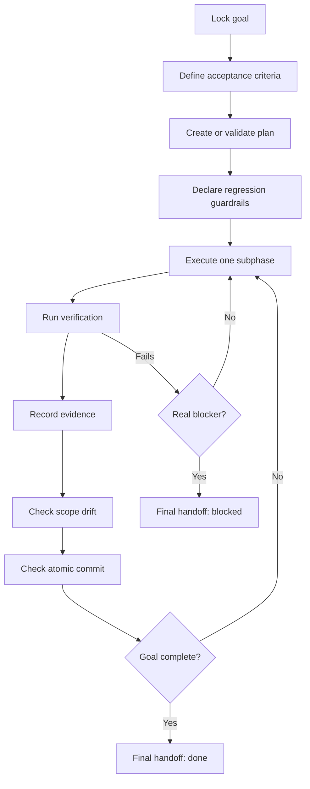

# Megaskill

Megaskill is a high-rigor execution skill for AI coding agents. It turns a broad coding goal into a guarded, step-by-step execution loop with explicit acceptance criteria, regression guardrails, atomic commits, verification evidence, and a final done/blocked/not-done verdict.

Use it when an agent needs to write a decision-complete plan for lower-level agents, prevent scope drift, execute iteratively, and prove the result with real checks instead of handing work back early.

## What It Provides

- Goal locking with acceptance criteria and out-of-scope boundaries.
- Plan validation for phases, subphases, tests, success criteria, planned touch files, and checklist items.
- Regression guardrail prompts before file edits.
- Scope drift checks against changed, staged, and untracked files.
- Atomic commit checks for staged changes.
- Evidence recording for verification commands.
- Final handoff structure with a clear `done`, `blocked`, or `not done` verdict.

## Execution Loop



## Install

### Codex

Recommended Codex install:

```bash
python3 ~/.codex/skills/.system/skill-installer/scripts/install-skill-from-github.py \
  --repo Kassden/megaskill \
  --path . \
  --name megaskill
```

For an editable install, clone this repo directly into your Codex skills directory:

```bash
mkdir -p ~/.codex/skills
git clone https://github.com/Kassden/megaskill.git ~/.codex/skills/megaskill
```

Restart Codex or start a new session, then ask for `$megaskill`.

### Claude Code

Install as a personal Claude Code skill:

```bash
mkdir -p ~/.claude/skills
git clone https://github.com/Kassden/megaskill.git ~/.claude/skills/megaskill
```

Or install it for one project:

```bash
mkdir -p .claude/skills
git clone https://github.com/Kassden/megaskill.git .claude/skills/megaskill
```

Restart Claude Code or start a new session, then ask Claude to use Megaskill for guarded execution planning and verification.

## Quick Start

Run commands from the Megaskill folder:

```bash
cd ~/.codex/skills/megaskill
```

Create a plan skeleton:

```bash
PYTHONDONTWRITEBYTECODE=1 python3 scripts/mega_plan_init.py \
  "Execution Plan" \
  --goal "Ship the requested change with tests and evidence" \
  --phases "Discovery,Implementation,Verification" \
  --output PLAN.md
```

Validate a plan before execution:

```bash
PYTHONDONTWRITEBYTECODE=1 python3 scripts/mega_plan_check.py PLAN.md
```

Check scope drift against the plan:

```bash
PYTHONDONTWRITEBYTECODE=1 python3 scripts/mega_scope_check.py PLAN.md
```

Check only staged files before committing:

```bash
PYTHONDONTWRITEBYTECODE=1 python3 scripts/mega_scope_check.py PLAN.md --staged
PYTHONDONTWRITEBYTECODE=1 python3 scripts/mega_commit_check.py
```

Record evidence for checks:

```bash
PYTHONDONTWRITEBYTECODE=1 python3 scripts/mega_evidence.py run \
  --phase "1.1" \
  -- npm test
```

Summarize recorded evidence:

```bash
PYTHONDONTWRITEBYTECODE=1 python3 scripts/mega_evidence.py summary
```

## Scripts

| Script | Purpose |
| --- | --- |
| `scripts/mega_plan_init.py` | Creates a canonical execution plan skeleton. |
| `scripts/mega_plan_check.py` | Validates plan structure before execution. |
| `scripts/mega_scope_check.py` | Compares planned touch files with working-tree, staged, and untracked changes. |
| `scripts/mega_commit_check.py` | Checks whether staged files look like one atomic commit. |
| `scripts/mega_evidence.py` | Records and summarizes verification evidence. |

## Skill Files

- `SKILL.md`: skill entrypoint and routing instructions.
- `references/execution-contract.md`: full execution loop and blocker rules.
- `references/agent-plan-template.md`: template for lower-level agent plans.
- `references/final-handoff-template.md`: final response proof block.
- `agents/openai.yaml`: OpenAI agent interface metadata.

## License

MIT
